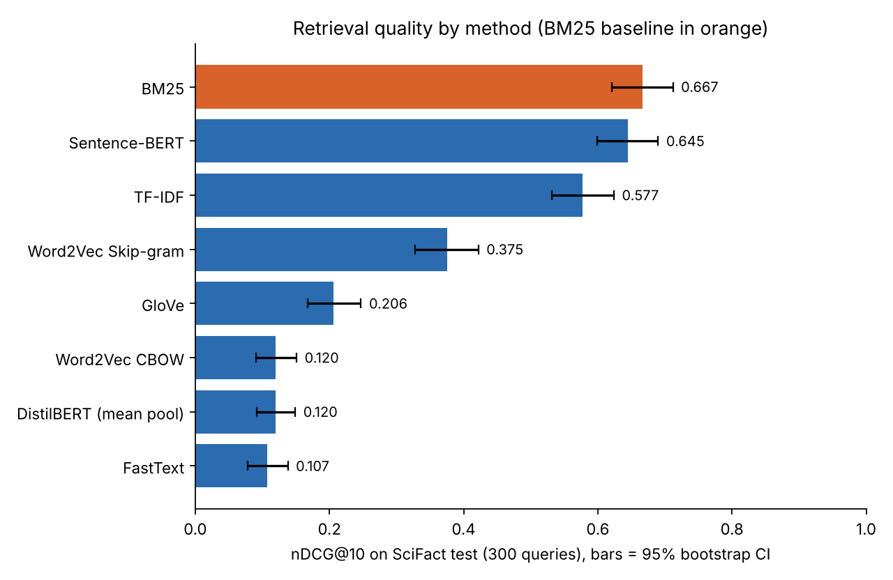

# Information Retrieval and NLP: From Boolean Search to Sentence-BERT


[](https://colab.research.google.com/github/Abdulbari-Alameer/Information-Retrieval-and-NLP/blob/main/notebooks/02_scifact_evaluation.ipynb)

Eight retrieval methods, from exact keyword matching to transformer embeddings, implemented and **evaluated against expert relevance judgements** on the SciFact benchmark, a corpus of 5,183 scientific abstracts with 300 test claims.

Started as a project for the Information Retrieval course in my Master's in Computer Science & Engineering at Tezpur University, then extended into a controlled benchmark comparison.

---

## Key results

nDCG@10 on the SciFact test set (BEIR version, 300 queries). The 95% intervals come from bootstrap resampling of queries; the p-values come from a paired randomisation test against BM25 with Holm correction.

| Method | nDCG@10 | 95% CI | Recall@10 | Recall@100 | MRR@10 | vs BM25 |
|---|---|---|---|---|---|---|
| **BM25** (baseline) | **0.667** | 0.621–0.712 | **0.784** | 0.879 | **0.635** | — |
| Sentence-BERT (`all-MiniLM-L6-v2`) | 0.645 | 0.599–0.690 | 0.783 | **0.925** | 0.605 | n.s. (p = 0.27) |
| TF-IDF | 0.577 | 0.531–0.624 | 0.720 | 0.888 | 0.541 | lower, p < 0.001 |
| Word2Vec Skip-gram | 0.375 | 0.328–0.422 | 0.510 | 0.781 | 0.341 | lower, p < 0.001 |
| GloVe (100-d) | 0.206 | 0.168–0.247 | 0.298 | 0.539 | 0.184 | lower, p < 0.001 |
| Word2Vec CBOW | 0.120 | 0.091–0.151 | 0.199 | 0.509 | 0.100 | lower, p < 0.001 |
| DistilBERT (mean pooling) | 0.120 | 0.092–0.149 | 0.205 | 0.509 | 0.099 | lower, p < 0.001 |
| FastText | 0.107 | 0.078–0.138 | 0.154 | 0.476 | 0.099 | lower, p < 0.001 |

Boolean retrieval returns unranked sets, so it is evaluated separately: **AND returns nothing for 96.7% of queries**, while OR returns a median of 1,545 abstracts with a precision of 0.001.

<p align="center">
  
</p>

**What the results show**

- **The implementation checks out against published numbers.** BM25 scores 0.667, against 0.665 reported in the BEIR paper, and Sentence-BERT scores 0.645, the value reported for `all-MiniLM-L6-v2` on SciFact in MTEB. Every metric also matches `pytrec_eval`.
- **BM25 and Sentence-BERT are statistically tied at the top, but they fail on different queries.** Sentence-BERT is better on 67 queries, worse on 72 and tied on 161, and it has the best Recall@100. That makes hybrid retrieval the natural next step.
- **BM25 beats TF-IDF by 9 points with the same tokens.** The difference comes from its term saturation and its document-length normalisation.
- **What a model is trained for matters more than its architecture.** DistilBERT, a transformer that was not trained for similarity, scores at the level of CBOW. Sentence-BERT, a transformer trained for similarity, is five times better.
- **Averaging word vectors blurs the technical terms that decide relevance** in scientific claims. Skip-gram is the best of the averaged-embedding methods, as expected from how it represents rare words.

---

## Notebooks

| Notebook | What it does |
|---|---|
| [`01_methods_walkthrough.ipynb`](notebooks/01_methods_walkthrough.ipynb) | Explains the seven methods on 8 short documents and one query, so each method's behaviour is easy to see. |
| [`02_scifact_evaluation.ipynb`](notebooks/02_scifact_evaluation.ipynb) | **The benchmark.** Runs every method on SciFact with the same preprocessing and fixed default settings, and computes nDCG@10, Recall@10/100 and MRR@10 with confidence intervals, significance tests, per-query analysis, limitations and references. |

Both notebooks include their outputs, so they can be read on GitHub without running anything. To reproduce the benchmark, open notebook 02 in Colab (badge above), choose a GPU runtime and run all cells. It takes about 10–15 minutes and downloads the data automatically.

### Evaluation protocol

- **Data:** SciFact from BEIR. 5,183 abstracts, 300 test queries, binary relevance, about 1.1 relevant abstracts per query.
- **Fairness:**
  - One tokenizer is shared by all lexical and static-embedding methods.
  - Hyperparameters are library or literature defaults, fixed before testing; nothing is tuned on the test set.
  - There is no fine-tuning.
  - Every method ranks the full corpus.
- **Metrics:**
  - nDCG@10 is the main metric, as in BEIR.
  - Recall@10, Recall@100 and MRR@10 are also reported.
  - Ties are broken as in `trec_eval`, and the metrics are verified against `pytrec_eval`.
- **Statistics:**
  - 10,000 bootstrap resamples give the 95% confidence intervals.
  - A paired randomisation test compares each method with BM25, with Holm correction across the comparisons.

### Methods

| Method | Type | Details |
|---|---|---|
| Boolean | Exact match | Inverted index with AND / OR / NOT |
| TF-IDF | Lexical | scikit-learn, cosine similarity |
| BM25 | Lexical | k1 = 1.2, b = 0.75, Lucene IDF, implemented with sparse matrices |
| Word2Vec CBOW / Skip-gram | Static embeddings | Trained on the corpus, 100-d, texts as the mean of their word vectors |
| FastText | Static embeddings | Trained on the corpus, uses character n-grams for unseen words |
| GloVe | Pretrained static | `glove-wiki-gigaword-100` |
| Sentence-BERT | Pretrained contextual | `all-MiniLM-L6-v2`, trained for semantic similarity |
| DistilBERT | Pretrained contextual | `distilbert-base-uncased`, mean pooling, not trained for similarity |

---

## Command-line demo

```bash
git clone https://github.com/Abdulbari-Alameer/Information-Retrieval-and-NLP.git
cd Information-Retrieval-and-NLP
pip install -r requirements.txt
python main.py
```

`main.py` loads `data/corpus.txt`, builds an inverted index and asks for a query. For each query it prints the Boolean matches and the TF-IDF ranking. Type `exit` to quit. The embedding models are in `src/`.

## Project structure

```
Information-Retrieval-and-NLP/
├── notebooks/
│   ├── 01_methods_walkthrough.ipynb    # seven methods on a toy corpus
│   └── 02_scifact_evaluation.ipynb     # benchmark on SciFact (BEIR)
├── reports/figures/
│   └── scifact_ndcg10.png
├── src/                                # modular implementations
│   ├── preprocessing.py, utils.py, config.py
│   ├── boolean_retrieval.py, tfidf_model.py
│   ├── embeddings.py                   # Word2Vec, GloVe, FastText
│   ├── bert_model.py, transformer_model.py
├── data/corpus.txt                     # toy corpus for main.py
├── main.py
├── requirements.txt
├── LICENSE
└── README.md
```

## Limitations

- Results come from one scientific dataset with 300 queries. Other domains may rank the methods differently.
- Relevance judgements are binary and incomplete, so relevant but unjudged abstracts count as misses.
- All methods use default settings. Tuned or retrieval-trained models would score higher.
- `all-MiniLM-L6-v2` was trained on data that includes scientific text, which may help it on SciFact.

## References

1. Wadden et al. (2020). *Fact or Fiction: Verifying Scientific Claims.* EMNLP.
2. Thakur et al. (2021). *BEIR: A Heterogeneous Benchmark for Zero-shot Evaluation of Information Retrieval Models.* NeurIPS Datasets and Benchmarks.
3. Robertson and Zaragoza (2009). *The Probabilistic Relevance Framework: BM25 and Beyond.* Foundations and Trends in IR.
4. Reimers and Gurevych (2019). *Sentence-BERT.* EMNLP.

The full list is in notebook 02.

## License

The code is released under the [MIT License](LICENSE). SciFact is downloaded from its official source and is not redistributed here.

## Author

**Abdulbari Al-Ameer**, Master's student in Computer Science & Engineering, Tezpur University · [GitHub](https://github.com/Abdulbari-Alameer) · [ORCID](https://orcid.org/0009-0000-7295-0943)
